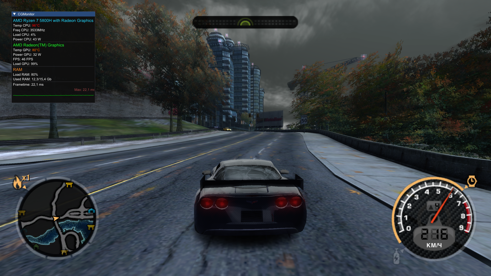

# CGMonitor

**English** | [Русский](README.ru.md)

> ⚠️ **Do not test this application in online games with anti-cheat.** Compatibility with anti-cheat systems (Easy Anti-Cheat, BattlEye, Vanguard, FACEIT AC, etc.) **has not been tested**. The overlay uses Present event interception (PresentMonFps) and hardware sensor access, which could theoretically be flagged by anti-cheat software as suspicious activity. Use at your own risk — in offline games, single-player modes, or a test environment.

A transparent Windows overlay that displays real-time system health metrics: CPU and GPU temperature, frequency, load, and power consumption, RAM usage, and a frametime graph. Rendered on top of other windows — designed for system monitoring during gaming or work.

The overlay is a standalone draggable window that does not interfere with interaction with other programs.

---

## Prerequisites

### PawnIO driver

Hardware sensor data is obtained via **LibreHardwareMonitor**. The **PawnIO** driver is required for low-level sensor access (especially on AMD Ryzen CPUs and NVIDIA/AMD GPUs).

Without PawnIO:

- CPU temperature may show as `0°C` or `N/A`
- CPU frequency may be unavailable
- CPU and GPU power consumption may not be displayed
- Some GPU sensors may be unavailable

Download PawnIO from the official project website or install it from the CGMonitor archive. Restart the application after installing the driver.

### Run as administrator

The application **must** be run as administrator. LibreHardwareMonitor and PawnIO require elevated privileges to access hardware sensors. Without admin rights, most metrics will be unavailable and the overlay will show zero or empty values.

---

## How metrics are calculated

### CPU

| Metric | Source | Details |
|---|---|---|
| **Temperature** | `Core (Tctl/Tdie)` → `CPU Package` | Priority to AMD `Tctl/Tdie`; falls back to `CPU Package` (Intel). Color: cyan (normal), orange (75–90°C), red (>90°C). |
| **Frequency** | Max across physical cores | Iterates `Clock` sensors containing `Core`, excluding `SMU`, `Effective`, `Average`, `Max`. Highest value shown in MHz. |
| **Load** | `CPU Total` (`Load`) | Overall CPU load percentage from LibreHardwareMonitor. |
| **Power** | `Package` (`Power`) | Total CPU package power in watts. |

### GPU

| Metric | Source | Details |
|---|---|---|
| **Temperature** | `GPU Core` / `GPU Package` / `GPU Hot Spot`; ADL for AMD mobile | Discrete GPUs use LibreHardwareMonitor sensors. AMD APUs additionally use **ADL** (`atiadlxx.dll`, `ADL2_OverdriveN_Temperature_Get`, type `EDGE`). |
| **Load** | `Gpu Load` / `D3D 3D` | Smoothed with factor 0.15. Shown as percentage. |
| **Power** | `GPU Package` / `GPU Core` / `GPU Total` / `GPU ASIC` / `Total Power` | For AMD APUs without a power sensor: package power minus sum of `Core #N` power, clamped to zero. |
| **FPS** | **PresentMonFps** | Tracks the foreground process via `GetForegroundWindow` + `GetWindowThreadProcessId`. Restarts tracking on process change. |
| **Frametime** | Derived from FPS | `1000 / FPS`, 6 jittered points per update (±0.5 ms, or ±2 ms below 40 FPS). Ring buffer of 100 values. |

> ⚠️ **Intel integrated graphics (HD/UHD/Iris Xe)** have **no dedicated GPU temperature sensor**. Temperature will not be displayed for Intel iGPUs — this is a hardware limitation, not an application limitation.

**Frametime graph:** 100 latest values, vertical scale 0–50 ms. Green line below 30 ms, red above. Red dashed line = 16.6 ms (60 FPS). Max value shown in the top-right corner.

### RAM

| Metric | Source | Details |
|---|---|---|
| **Load** | `Memory` (`Load`) | RAM usage percentage. |
| **Used** | `Memory Used` (`Data`) | Used memory in GB. |
| **Total** | `Memory Used` + `Memory Available` | Sum of used and available memory, in GB. |

---

## Libraries used

| Library | Purpose |
|---|---|
| **ClickableTransparentOverlay** (v9) | Transparent clickable overlay |
| **ImGui.NET** | Overlay UI rendering |
| **LibreHardwareMonitor** | Hardware sensor data |
| **PresentMonFps** | FPS via Present event interception |
| **ADL** (`atiadlxx.dll`) | AMD mobile GPU temperature |

---

## System requirements

| Requirement | Details |
|---|---|
| **OS** | Windows 10 or Windows 11 (64-bit) |
| **CPU** | Any x64-compatible |
| **.NET** | **.NET 10.0** (self-contained build needs no .NET install) |
| **PawnIO driver** | Required for full sensor functionality |
| **Administrator rights** | Required |

---

## When data may not be displayed

1. **PawnIO driver is not installed** — CPU/GPU temperature, frequency, and power may be unavailable or zero.
2. **Not run as administrator** — most sensors will be unavailable.
3. **Intel integrated graphics** — no dedicated temperature sensor; GPU temperature is not displayed.
4. **Sensor missing on specific hardware** — some laptops do not expose the GPU temperature sensor. AMD mobile GPUs fall back to ADL; if unavailable, temperature is not shown.
5. **FPS not displayed** — foreground is desktop/Explorer, or the app does not use a PresentMon-compatible presentation method (some Vulkan/OpenGL games, older apps). Also if PresentMonFps cannot obtain the PID (FPS may also be displayed on the desktop — this is a PresentMonFps behavior).
6. **GPU power missing** — no power sensor on some mobile GPUs; difference-based calculation may also fail (some older GPUs do not report power draw, so GPU power may match CPU power consumption).
7. **RAM incorrect** — `Memory Used` / `Memory Available` sensors missing on some motherboards.
8. **Overlay does not appear** — not run as administrator, or PawnIO missing and LibreHardwareMonitor fails to initialize. Also check antivirus blocking.

 <small>Program interface and usage example (version 2.0.0)</small>

